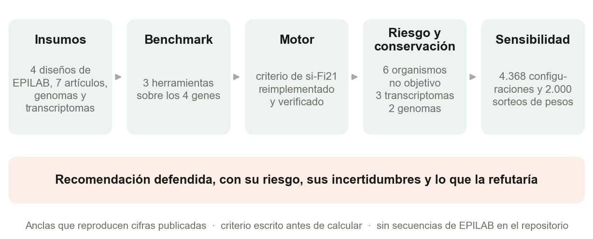
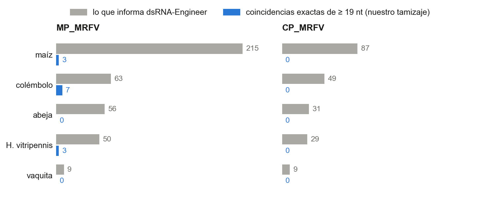
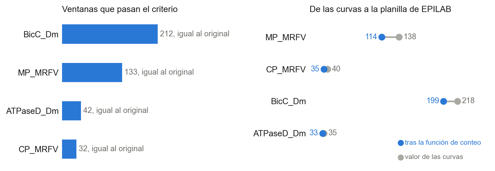
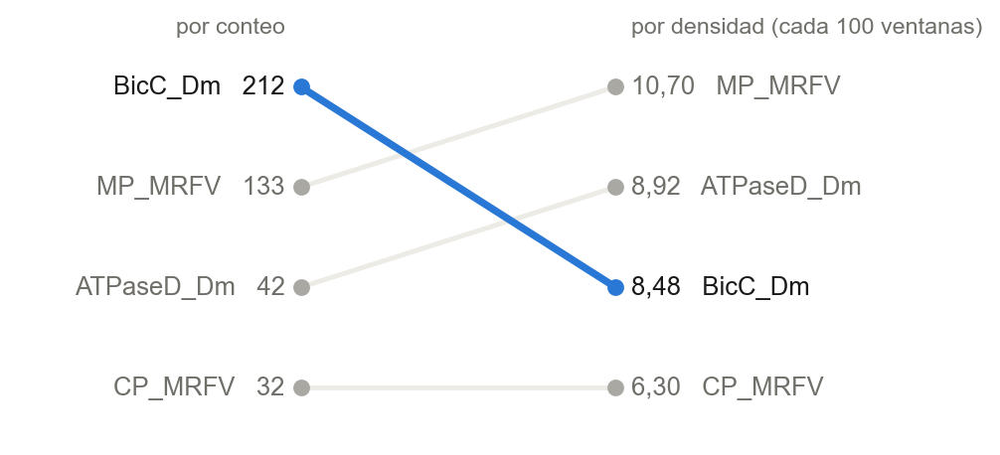
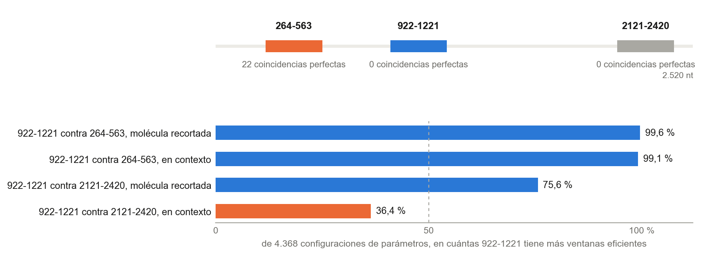
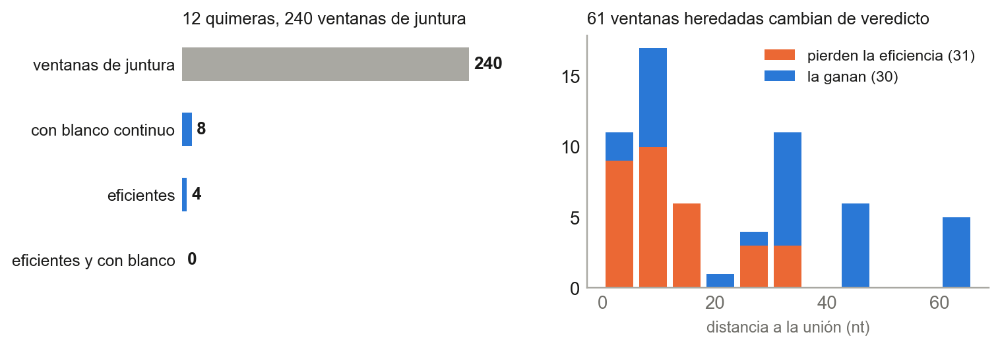
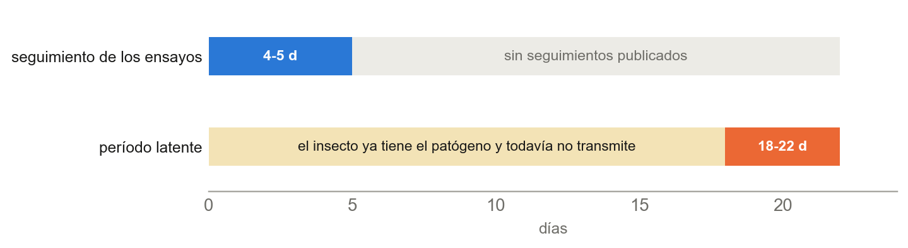

## Resumen

El complejo de achaparramiento del maíz lo transmite una chicharrita, *Dalbulus maidis*, y el laboratorio EPILAB (IFIBYNE, UBA-CONICET) plantea controlarlo con ARN de doble cadena (ARNdc) que silencie genes del insecto o del virus. Nuestro equipo no cuenta con laboratorio, de modo que nos preguntamos qué se puede decidir con rigor sin hacer un solo experimento. Partimos de cinco hipótesis, y de cada una de ellas salió una parte del trabajo. Comparamos las tres herramientas de diseño disponibles sobre los cuatro genes de partida, reimplementamos en Python el criterio de eficiencia de si-Fi21, lo verificamos contra el programa original, y con ese motor auditamos las regiones elegidas por EPILAB: su riesgo sobre seis organismos no objetivo, su conservación entre fuentes y su sensibilidad a 4.368 configuraciones de parámetros.

Cuatro resultados organizan el informe. Primero, ninguna de las tres herramientas estima eficacia, y el conteo de off-target de dsRNA-Engineer viene casi por completo de una condición indistinguible del azar. Segundo, una ventana «eficiente» es el sí o el no de una regla de diseño y no una medida de silenciamiento, y los datos abiertos no alcanzan para validar esa regla. Tercero, las dos regiones que EPILAB eligió para genes del insecto contienen ventanas idénticas a un transcripto de otro cicadélido, *Homalodisca vitripennis*; moviendo la región dentro del mismo gen el problema desaparece, y recomendamos `BicC_Dm` 922-1221, con una firmeza muy distinta según contra qué región se la compare. Cuarto, en quimeras de varios genes el riesgo de off-target se hereda de las partes mientras que la eficacia hay que recalcularla. Cerramos con lo que no sabemos y con los tres experimentos que refutarían la recomendación.

## 1. Introducción

### 1.1 Contexto y antecedentes

*Dalbulus maidis* es un cicadélido especialista en el género *Zea* que se alimenta del floema (Jones y Medina 2020). El daño directo de su alimentación importa menos que su papel de vector: transmite de manera persistente y propagativa los patógenos que, solos o combinados, producen el complejo de achaparramiento del maíz, entre ellos la bacteria sin pared celular *Spiroplasma kunkelii*, un fitoplasma y el virus del rayado fino del maíz (maize rayado fino virus, MRFV). Persistente y propagativa significa que el agente se multiplica dentro del insecto, que debe pasar por su intestino y llegar a las glándulas salivales, y que desde entonces el insecto transmite durante toda su vida. En *S. kunkelii* ese período de latencia dura entre 18 y 22 días (Jones y Medina 2020). Las pérdidas de rendimiento atribuidas al complejo se reportan entre 40 y 100 % según el episodio y el método, con un caso extremo en el sur de Florida en 1979-1980 (Jones y Medina 2020), y las cifras no son comparables entre estudios.

### 1.2 Planteamiento del problema

Los cuatro diseños de EPILAB con los que trabajamos se eligieron hace unos dos años con un criterio de eficiencia calculado con si-Fi21, y nunca se probaron en laboratorio. Tres vacíos dificultan juzgarlos. La herramienta oficial de diseño cuenta coincidencias y no estima eficacia, y el criterio de si-Fi21 se validó una sola vez, como herramienta completa y no por umbral, en una cebada atacada por un hongo. Además, el número de ventanas eficientes de una región se usa como si comparara regiones y genes, sin que esté establecido cuánto depende de cómo se cuenta. Y el riesgo sobre organismos no objetivo, que debe pesar tanto como la eficacia, no aparece evaluado en ninguno de los siete artículos de partida, según nuestra lectura. A esto se suma una restricción propia: el equipo no dispone de laboratorio.

### 1.3 Hipótesis y objetivo

La pregunta que guía el trabajo es cómo diseñar y priorizar una solución basada en ARN exógeno que use el mecanismo de RNAi para silenciar genes del vector o de los patógenos asociados, de manera biológicamente informada y reproducible, con mayor probabilidad de acción y menor riesgo para el maíz, los organismos no objetivo y el ecosistema. Acotada a lo que se puede resolver sin experimentos, es qué decisiones sobre el diseño del ARNdc se pueden tomar y defender con datos públicos y cálculo, y cuáles no. El **objetivo general** es auditar con métodos computacionales reproducibles los diseños de EPILAB contra *D. maidis* y el MRFV, y priorizar regiones y blancos según eficiencia predicha, riesgo fuera del blanco y conservación.

Para cumplirlo partimos de cinco hipótesis, formuladas antes de calcular. La Tabla 1 dice, de cada una, por qué la planteamos, para qué sirve saber si es cierta y cómo la pusimos a prueba. El resto del informe sigue ese orden.

**Tabla 1.** Las cinco hipótesis de partida, con su motivo, su utilidad y su prueba.

| Hipótesis | Por qué | Para qué | Cómo |
| --- | --- | --- | --- |
| **H1.** Las herramientas oficiales no estiman eficacia ni miden el riesgo de una forma interpretable. | Las herramientas de diseño disponibles se usan para elegir regiones, pero nunca se compararon entre sí sobre los mismos genes, y nuestras notas de partida suponían cosas que no habíamos verificado. | Saber qué herramienta sirve para qué, y qué hay que rehacer por cuenta propia. | Las tres herramientas sobre los mismos genes y los mismos ensamblados, y lectura de su código. |
| **H2.** «Eficiente» es el resultado de una regla de diseño y no una medida de silenciamiento, y el número de ventanas no compara regiones ni genes. | Nadie validó los umbrales en insectos, y la planilla del laboratorio usa el conteo para elegir. | Decidir cuánto peso darle al conteo en una recomendación. | Reimplementación verificada de si-Fi21, lectura de sus umbrales, validación retrospectiva con datos abiertos y comparación de marcos de conteo. |
| **H3.** Las regiones elegidas para el insecto concentran coincidencias con organismos no objetivo que otra región del mismo gen no tiene. | Ningún artículo de partida evalúa no objetivo, y un diseño tiene que reducir el riesgo para el maíz y el ecosistema. | Recomendar una región por gen, con su contracara de riesgo. | Panel de seis organismos, alertas por bloque de 19 nt y conservación entre transcriptomas y genomas. |
| **H4.** Las conclusiones dependen más de decisiones que no son nuestras que de los parámetros finos. | Una recomendación puede cambiar según los pesos y los parámetros, y hay un organismo no objetivo cuya exposición nadie puede fijar. | Separar lo firme de lo frágil, y dejar a la vista lo que decide otra persona. | 4.368 configuraciones, 2.000 sorteos de pesos y la exposición en sus dos extremos. |
| **H5.** Una quimera hereda el riesgo de sus partes pero no su eficacia predicha. | Combinar fenotipos que no se solapan permite cubrir lo que un gen solo no hace, y la juntura entre fragmentos es una secuencia que no existe en ningún gen. | Cubrir lo que `BicC_Dm` no hace, que es cortar la transmisión en la temporada. | Conteo de la juntura aparte, evaluación de doce quimeras y un enumerador de combinaciones. |

### 1.4 Alcance y justificación

El equipo reúne cuatro estudiantes de Ingeniería en Inteligencia Artificial, sin formación biológica previa. Al comienzo decidimos no competir en el eje de biología experimental y concentrarnos en bioinformática y datos, desarrollo computacional e innovación abierta. De esa decisión se desprende la regla que gobernó el trabajo: lo que se proponga tiene que poder demostrarse sin experimentos húmedos, y lo que no pueda demostrarse figura como límite y no como resultado. El trabajo se limita al control fitosanitario con información pública. Queda fuera, sin excepción, todo lo que aumente la virulencia, la transmisibilidad o el rango de hospedadores de un patógeno, y todo diseño dirigido a dañar especies no objetivo. Cada propuesta de diseño incluye su contracara de riesgo.

Este informe se organiza alrededor del razonamiento: el porqué y el para qué de cada paso, qué se comparó y qué lecturas biológicas surgieron. Una convención: en el texto distinguimos lo que medimos nosotros, lo que reportan las fuentes y lo que es hipótesis o lectura nuestra, y lo decimos con palabras cada vez que importa.

## 2. Marco teórico

### 2.1 Interferencia por ARN y sus límites

El silenciamiento génico por ARN de interferencia (RNAi) ofrece una vía de control con especificidad de secuencia. Un ARN de doble cadena entra a la célula, la enzima Dicer lo corta en fragmentos de 21 a 22 nucleótidos (siRNA) y una de las dos hebras de cada fragmento guía al complejo Argonauta hacia el ARN mensajero complementario, que se degrada (Elbashir *et al.* 2001). El mecanismo fija dos límites que ordenaron nuestra estrategia desde el primer día. El primero es que no opera sobre bacterias: los mollicutes carecen de la maquinaria, y ninguna de las revisiones de 2026 que revisamos propone silenciarlos, de modo que el ARNdc sólo puede dirigirse al insecto o al virus mientras replica dentro de la planta. El segundo es que la especificidad no es absoluta. Una secuencia de 19 nucleótidos o más coincidente con un transcripto ajeno es el criterio que la literatura usa para marcar riesgo de silenciamiento fuera del blanco (Cedden 2026), y ahí entran el maíz, los polinizadores y los enemigos naturales.

### 2.2 El criterio de eficiencia y las herramientas de diseño

El criterio de eficiencia que usa el laboratorio viene de si-Fi21 (Lück *et al.* 2019). La herramienta recorre el gen con una ventana de 21 nt y le pide a cada ventana tres cosas: que la hebra guía sea la que se carga según la asimetría termodinámica de los extremos, que esa diferencia alcance un margen mínimo y que el sitio del mensajero esté accesible, algo que calcula con RNAplfold, del paquete ViennaRNA (Lorenz *et al.* 2011). Una cuarta regla sobre los nucleótidos de los extremos 5′ completa el veredicto. La otra herramienta de diseño disponible, dsRNA-Engineer, es de naturaleza distinta, y BLAST resuelve homología. Qué hace en la práctica cada una lo medimos en la sección 4.1.

### 2.3 Entrega del ARN y tiempo hasta el efecto

En la investigación previa, hecha con fuentes públicas, tres puntos se corrigieron al contrastar con los materiales recibidos después, y las correcciones se conservaron fechadas en el repositorio sin reescribir lo anterior. El ARN exógeno aplicado a la planta llega al apoplasto, al xilema y a las células de la vaina del haz, y tres trabajos de la bibliografía de partida, con tres técnicas distintas, no hallan evidencia de que llegue al floema, que es donde se alimenta el insecto (Mitter *et al.* 2017; Rossi *et al.* 2024; Balassa *et al.* 2024). La vía de entrega que esos trabajos habilitan sería entonces la adquisición durante el sondeo de xilema, que *D. maidis* también realiza. Es una hipótesis nuestra, apoyada en un dato de electropenetrografía de la propia especie. Además, los porcentajes de supervivencia que habíamos atribuido a *D. maidis* en un artículo estaban cruzados con los de otra especie, y el 95 % de reducción del transcripto descansaba en tres réplicas de tres ninfas. Por último, el blanco del ensayo oral no era la ATP sintasa sino la V-ATPasa, un complejo distinto.

## 3. Metodología

### 3.1 Material de estudio

Partimos de siete artículos, dos bases de datos, dos herramientas de diseño y verificación y las secuencias de cuatro diseños de EPILAB. Dos son del virus, `MP_MRFV` (proteína de movimiento, 1.263 nt) y `CP_MRFV` (cápside, 528 nt). Los otros dos son del insecto: `BicC_Dm` (*Bicaudal C*, 2.520 nt) y `ATPaseD_Dm` (subunidad D de la ATPasa vacuolar de protones, 491 nt). Sumamos además dos genes de *D. maidis* con fenotipo publicado, `eth` y `burs-α`, ambos reguladores de la muda (Andrada *et al.* 2026). Los cuatro diseños datan de hace unos dos años y nunca se probaron en laboratorio, porque la incidencia de la plaga bajó y el grupo se quedó sin material experimental. El ejercicio dejó de ser reproducir un resultado validado y pasó a ser auditar una decisión vieja, de la que ni su autor recordaba con certeza los motivos.

**Tabla 2.** Genes de estudio: los cuatro diseños de EPILAB y los dos genes agregados.

| Gen | Organismo | Función | Largo (nt) | Origen |
| --- | --- | --- | --- | --- |
| `MP_MRFV` | MRFV | proteína de movimiento | 1.263 | EPILAB |
| `CP_MRFV` | MRFV | proteína de la cápside | 528 | EPILAB |
| `BicC_Dm` | *D. maidis* | *Bicaudal C*, oogénesis | 2.520 | EPILAB |
| `ATPaseD_Dm` | *D. maidis* | subunidad D de la V-ATPasa | 491 | EPILAB |
| `eth` | *D. maidis* | hormona desencadenante de la ecdisis | n/d | Andrada *et al.* 2026 |
| `burs-α` | *D. maidis* | bursicón α, muda | n/d | Andrada *et al.* 2026 |

### 3.2 Diseño general

La Figura 1 resume la cadena de análisis. Cada etapa tiene entrada, salida y script en el repositorio, y las cifras de este informe se leen de archivos versionados.

### 3.3 Benchmark de las herramientas

Pusimos a prueba H1 comparando las tres herramientas disponibles, si-Fi21, dsRNA-Engineer y BLAST+, sobre los cuatro genes de EPILAB. El único eje que las tres tocan es el de off-target: si-Fi21 mide eficiencia y no especificidad, BLAST mide similitud y no eficiencia, y dsRNA-Engineer dice medir las dos. Antes de comparar verificamos que las herramientas miraran los mismos datos. Las cinco referencias no objetivo de dsRNA-Engineer son exactamente los mismos ensamblados que usamos en el tamizaje local; la única diferencia es la del vector, para el que ellos usan un ensamblado propio, y ahí los números no se comparan.

dsRNA-Engineer corre sólo como servicio web, con procesamiento del lado del servidor y sin política de retención declarada. Por eso no subimos ninguna secuencia no publicada. Comprobamos byte a byte que los dos genes virales son subcadenas exactas de un registro público del NCBI y que, por lo tanto, subirlos no revela nada, y sólo esos dos se corrieron. El benchmark de los dos genes del insecto se hizo con dos herramientas y no con tres. Para BLAST+ plantamos desajustes en cada una de las 21 posiciones de 3.150 consultas y medimos cuántos recuperaba cada configuración.

### 3.4 Motor de eficiencia

Reimplementamos el criterio de si-Fi21 en Python 3, sin interfaz gráfica y con dos modos. El modo `fiel` reproduce el programa original, incluidos sus defectos, para poder auditar números hechos con él. El modo `corregido` aplica los arreglos documentados. Una ventana de 21 nt se considera aprobada cuando cumple cuatro reglas: la hebra guía es la que se carga según la asimetría termodinámica de los extremos, la diferencia es de al menos 1 kcal/mol, el sitio del mensajero está accesible (probabilidad de al menos 0,1 de que 8 nt queden desapareados, calculada con RNAplfold) y se satisface la preferencia de nucleótido en los extremos 5′. Leímos el artículo, el manual y el código fuente de si-Fi21 para fijar de dónde sale cada umbral. El resultado de esa lectura se vuelve importante en la sección 4.2.

### 3.5 Riesgo fuera del blanco

El panel de organismos no objetivo contiene maíz, *Harmonia axyridis* (vaquita, enemigo natural), *Apis mellifera* (abeja), *Homalodisca vitripennis* (cicadélido norteamericano, usado como representante de los cicadélidos porque no existen transcriptomas públicos de cicadélidos nativos no plaga), *Folsomia candida* (colémbolo) y humano. *D. maidis* se excluye por ser el blanco. Para cada ventana buscamos coincidencias exactas de 21 nt contra las referencias locales, con Bowtie y con un autómata de Aho-Corasick propio, y registramos además las coincidencias en bloque de al menos 19 nt. El tamizaje con Bowtie sobre 575 Mb tarda 27,6 segundos. Una coincidencia perfecta de 21 nt es un veto y no una penalización, decisión nuestra y declarada, porque se trata de una coincidencia exacta de secuencia y no de una predicción termodinámica.

### 3.6 Conservación

Para cada ventana eficiente medimos si es idéntica en tres transcriptomas públicos de *D. maidis* (Argentina, Ohio e Illinois) y en dos genomas (uno del Reino Unido, de calidad cromosómica, y otro de Córdoba), y para el virus, en 71 registros de MRFV de GenBank. Una fuente que no cubre una región se declara «sin datos» y no se cuenta como cero.

### 3.7 Sensibilidad

Una recomendación que depende de un umbral arbitrario no se sostiene sola. Barrimos cinco ejes (umbral de accesibilidad, brecha de estabilidad de extremos, modo, tabla de energías y motor de plegado), que dan 4.368 configuraciones, y sorteamos 2.000 veces los pesos del ranking. Lo que se informa en cada caso es la fracción de configuraciones o sorteos en que una conclusión se mantiene.

### 3.8 Quimeras y genes nuevos

Evaluamos moléculas que unen fragmentos de dos genes, contando por separado las ventanas que pertenecen a un solo fragmento y las que cruzan la unión. Para encontrar candidatos nuevos transferimos anotación por homología desde organismos mejor anotados hacia un transcriptoma sin anotar, y ordenamos los genes con un criterio escrito antes de calcular.

### 3.9 Reglas de trabajo

Cuatro hábitos explican por qué las cifras son confiables y conviene nombrarlos. Las líneas de análisis empiezan reproduciendo un número ya publicado, y abortan si no coincide. El criterio de decisión se escribe y se confirma en el repositorio antes del primer cálculo, y lo que cambia después entra como enmienda con fecha. Los descartes se documentan con el mismo cuidado que los hallazgos. Y ningún artículo se cita sin haberlo abierto; lo que sólo pudimos leer en resumen figura como tal.

## 4. Resultados

### 4.1 Benchmark de las tres herramientas (H1)

La primera hipótesis se sostiene. Las tres herramientas no miden lo mismo (Tabla 3), y ninguna estima eficacia de silenciamiento. La más cercana es si-Fi21, que calcula un veredicto por ventana a partir de reglas termodinámicas y de accesibilidad; dsRNA-Engineer suma coincidencias de Bowtie; y BLAST resuelve homología. Nuestras notas de partida suponían que BLAST «separa en porciones y calcula la termodinámica», y la lectura del código mostró que no es así. La confusión probablemente viene de Primer-BLAST, que sí calcula temperaturas de fusión de cebadores.

**Tabla 3.** Qué calcula cada herramienta y qué defecto principal medimos en los cuatro genes de EPILAB.

| Herramienta | Qué calcula | Uso con material no publicado | Defecto principal medido |
| --- | --- | --- | --- |
| si-Fi21 | Veredicto sí o no por ventana de 21 nt, con termodinámica y accesibilidad. Es un criterio de diseño. | Sí, pero sólo en Windows y sin automatizar | Una rama de la regla terminal declara eficiente sin consultar la termodinámica: del 14 al 24 % de lo que reporta. |
| dsRNA-Engineer | Suma de coincidencias de Bowtie en tres condiciones (21 pb, 16 pb y 26 pb con hasta 2 desajustes). | No: sólo servicio web | Todo el riesgo que informa sale de la condición de 16 pb, indistinguible del azar. |
| BLAST+ | Homología y anotación | Sí | No encuentra todos los 21-meros con un desajuste: sensibilidad máxima de 0,762 y cero con la configuración por defecto. |

El defecto de dsRNA-Engineer es el más grande. Para `CP_MRFV` informa 87 off-targets en maíz, un gen para el que nuestro tamizaje exacto no encuentra ni una sola coincidencia de 19 nt o más contra ninguna de las seis referencias. Para `MP_MRFV` informa 215 contra 3 (Figura 2). No se trata de un desacuerdo, sino de que no cuentan lo mismo. Si el número viniera de la condición de 21 pb, nuestro conteo a 21 nt debería ser parecido, y es cero en las doce celdas; si viniera de la de 16 pb, nuestro conteo a 16 nt debería parecerse, y se parece. Y a 16 nucleótidos lo observado equivale a 0,95 veces lo que daría una secuencia aleatoria con la misma composición. La señal aparece desde los 18 nt (1,95 veces) y se dispara a los 19 (4,76 veces). Un número que saldría igual con secuencia al azar no mide riesgo, y de esa condición sale todo lo que la herramienta informa. Tiene además dos limitaciones prácticas: no incluye el MRFV en su panel, así que no puede calcular blanco propio para los dos genes virales, y recomienda fragmentos de 51 a 91 pb, que no se superponen con las regiones de 200 a 300 nt que el laboratorio sintetiza. En su favor, su panel tiene 1.103 especies, contra seis del nuestro, y para un tamizaje amplio de material ya publicado es la herramienta indicada.

BLAST+ falla de otra manera. Sobre 3.150 consultas con un desajuste plantado en cada posición, la mejor configuración alcanza una sensibilidad de 0,762 y `megablast` por defecto da cero en las 21 posiciones, porque un 21-mero con un desajuste en el medio queda partido en dos bloques de 10 y no siembra, y la extensión recorta el desajuste en vez de cruzarlo. Sobre nuestros datos, el criterio de un desajuste calculado con BLAST+ queda por debajo del exacto por un factor de hasta 3,2 (5 contra 16 en `BicC_Dm`, 9 contra 17 en `ATPaseD_Dm`). Hay además una trampa fácil de cometer: `-perc_identity` filtra sobre el alineamiento que BLAST encontró y no sobre la consulta completa, y al pedir 590 ventanas de 26 nt devolvió 827 filas de las que ninguna era de 26 nt. Contar filas como cantidad de off-targets sobreestima el riesgo por factores de cientos. Para los criterios de bloque perfecto, en cambio, BLAST+ y nuestro tamizaje coinciden en las 20 celdas comparadas, lo que valida a las dos implementaciones.

En el código público del laboratorio encontramos un caso que ilustra el costo de no poder auditar: una secuencia en minúsculas produce cero eficientes sin avisar de ningún error, porque la rutina que pasa a mayúsculas no guarda su resultado (138 eficientes en mayúsculas contra 0 en minúsculas, en `MP_MRFV`). De todo esto sale la división de trabajo que adoptamos: si-Fi21, reimplementado, para eficiencia, que no tiene alternativa; el tamizaje exacto local para off-target; y BLAST sólo para explorar a qué se parece una secuencia. Las mejoras que propondríamos son baratas. Para si-Fi21, guardar el veredicto de cada ventana con sus términos, hacer que la regla terminal filtre en vez de ramificar y exponer la temperatura como parámetro. Para dsRNA-Engineer, separar el número en sus condiciones, marcar la de 16 pb como exploratoria y ofrecer una versión local.

### 4.2 El motor reproduce al original, y la planilla se explica (H2)

Para poner a prueba H2 hacía falta un criterio de eficiencia que se pudiera auditar ventana por ventana, y la salida de si-Fi21 sólo trae una fila por gen. Lo primero fue reproducirlo.

Corrido con su interfaz y los valores por defecto, si-Fi21 aprueba 42, 32, 133 y 212 ventanas en `ATPaseD_Dm`, `CP_MRFV`, `MP_MRFV` y `BicC_Dm`. Nuestro motor en modo `fiel`, con el mismo RNAplfold 2.1.5, da los mismos cuatro números (Figura 3a). La planilla de EPILAB declara otros valores, 114, 35, 199 y 33, y durante días no pudimos explicar la brecha; ensayamos una hipótesis sobre el conteo de aciertos de Bowtie que resultó ser una coincidencia en un solo gen y que retiramos. La explicación está en la función histórica con la que el laboratorio cuenta las ventanas: asigna 20 posiciones de cobertura a cada ventana de 21 nt y registra una ventana nueva sólo cuando la curva sube, de modo que una ventana eficiente que empieza donde otra termina no se cuenta. Implementada esa regla sobre nuestro propio conjunto de ventanas, 138, 40, 218 y 35 pasan a 114, 35, 199 y 33, los cuatro valores de la planilla, exactos (Figura 3b). Con anchos de cobertura de 19 o de 21 no se reproducen los cuatro, así que el ancho queda identificado en 20.

La reproducción tiene una segunda lectura, menos cómoda. La función de conteo oculta entre el 5,7 y el 17,4 % de las ventanas eficientes según el gen, y el sesgo no es constante, así que dos cifras de la planilla no son comparables entre sí. Aplicada a regiones de 300 nt, el sesgo va de 0 a 22,2 % y el empate «36 contra 35» entre dos regiones candidatas de `BicC_Dm` se vuelve un empate exacto, 33 a 33.

### 4.3 «Eficiente» no es «silencia» (H2)

Que una ventana sea «eficiente» significa que pasó una regla enunciada, y esa regla tiene fundamentos desiguales. De los umbrales que deciden el veredicto, sólo dos tienen fuente experimental abierta y específica, el tamaño de 21 nt y la preferencia de nucleótido terminal (Elbashir *et al.* 2001; Ui-Tei *et al.* 2004). Otros dos tienen fuente para el principio pero no para el valor numérico, y dos no tienen ninguna: el margen de 1 kcal/mol, que duplica el de 0,5 kcal/mol observado en la literatura sin derivarse de él, y la temperatura de 22 °C, que el artículo no menciona. El artículo validó la herramienta completa con doce construcciones en cebada contra un hongo, midiendo fenotipo y no caída del transcripto, de modo que ningún siRNA individual fue medido (Lück *et al.* 2019).

Al leer el código encontramos además que la regla del nucleótido terminal no filtra sino que ramifica: cuando el nucleótido 19 es A o T y el 2 no lo es, una rama devuelve «eficiente» sin consultar el veredicto termodinámico. En los cuatro genes esa rama explica entre el 14 y el 24 % de lo que el programa reporta; en `BicC_Dm`, con el motor actual, 134 de las 223 ventanas del modo `fiel`, el 60,1 %. Su preferencia de secuencia suma evidencia sobre qué hebra se carga y no sustituye la asimetría termodinámica, así que la consideramos un defecto y no una decisión. El modo `corregido` la trata como una condición más.

Quisimos saber si el filtro predice eficacia. Los únicos datos abiertos con la unidad correcta (siRNA individuales con eficacia medida, en un insecto) son 29 siRNA del escarabajo *Tribolium castaneum* (Cedden *et al.* 2025). La correlación entre el filtro y el efecto da ρ = +0,142, con intervalo de confianza del 95 % de −0,247 a +0,492 (Figura 4a). El intervalo incluye el cero y también incluye 0,35, que es lo que se observaría con un criterio bueno, de modo que el dato no decide. Tampoco podía decidir entre los dos modos del filtro: difieren en un solo siRNA de los 29 y el valor p exacto es 1,00. Para distinguirlos con potencia de 0,80 harían falta 2.784 siRNA medidos, o 232 en el supuesto más optimista, y no existen datos públicos de ese tamaño. Con otros umbrales de accesibilidad la precisión del filtro sólo supera a la de aprobar todo en el valor más bajo explorado (Figura 4b). De ahí la propuesta experimental que cierra el informe.

### 4.4 El conteo no compara genes (H2)

El número de ventanas eficientes de un gen depende de su largo y por eso no mide la calidad del blanco. Normalizado por largo, `BicC_Dm` pasa del primer puesto por conteo (212 ventanas) al tercero por densidad (8,48 cada 100), detrás de `MP_MRFV` (10,70) y `ATPaseD_Dm` (8,92) (Figura 5). Cambiar RNAplfold 2.1.5 por ViennaRNA 2.7.2 sin tocar nada más mueve los cuatro conteos a 142, 39, 223 y 35 e intercambia el tercer puesto con el cuarto, y contar la molécula de 300 nt recortada y plegada sola, en lugar de las mismas posiciones dentro del gen, baja de 36 a 26 las ventanas de `BicC_Dm` 922-1221. Por eso cada conteo se publica con su marco declarado, y el equipo distingue el conteo dentro del gen (todos los arranques en contexto), el de los arranques comparables y el de la molécula recortada, que es la cifra que se publica.

Por la misma razón presentamos dos listas, una por mecanismo, y no un ranking único. Una lista reúne los blancos del insecto (`BicC_Dm`, `eth`, `burs-α`, `ATPaseD_Dm`) y la otra los del virus (`MP_MRFV`, `CP_MRFV`). Juntarlas pondría arriba a los virales por un artefacto de largo, y la comparación de estrategias dirigidas a organismos distintos necesita un eje que el número de ventanas no contiene.

### 4.5 El riesgo, y la región que se mueve (H3)

H3 se sostiene: las dos regiones que EPILAB eligió para los genes del insecto contienen ventanas de 21 nt idénticas a un transcripto de *H. vitripennis*: 22 en `BicC_Dm` 264-563 y 3 en `ATPaseD_Dm` 151-450. Un cicadélido no objetivo con coincidencias perfectas es exactamente el tipo de resultado que el tamizaje busca, y ese organismo no figuraba en el panel de referencia del laboratorio.

La respuesta no consiste en cambiar de gen sino en mover la región dentro del gen. Para `BicC_Dm`, la región 922-1221 tiene 0 coincidencias perfectas con el panel, contra 22 de la planilla, y 3 alertas por bloque de al menos 19 nt, contra 33 de 264-563 y 6 de 2121-2420. Ninguna de sus 2.500 ventanas es de baja complejidad. Además se conserva: sus 36 ventanas eficientes en contexto son idénticas en el transcriptoma argentino y en el genoma del Reino Unido, y 32 de 36 lo son en el de Ohio, mientras que el de Illinois no cubre esa región. Para `ATPaseD_Dm`, la región 72-371 pasa de 3 a 0 coincidencias. El efecto sobre el orden también es visible: con las regiones movidas, `BicC_Dm` queda primero de la lista del insecto en las diez combinaciones de agregación a 21 nt, entre el 53,0 y el 100 % de 2.000 sorteos de pesos, mientras que con las regiones de la planilla ocupaba el tercer o cuarto lugar.

### 4.6 La recomendación y cuánto aguanta (H3 y H4)

Recomendamos `BicC_Dm` 922-1221, una molécula de ARNdc de 300 nt. Su perfil, en el punto por defecto del modo `corregido`, es de 26 ventanas que pasan el criterio contando la molécula que se sintetizaría (36 contando todos los arranques en el gen y 29 los comparables), ninguna coincidencia perfecta con el panel y las tres alertas mencionadas.

Conviene decir con claridad lo que no hace fuerte a esta recomendación, que es el conteo. Por densidad el gen cae al tercer puesto, y el margen de 922-1221 sobre otra región candidata, 2121-2420, es de una ventana en contexto y de cuatro en la molécula. La Figura 6b muestra cuánto resiste. Contra la región de la planilla (264-563), 922-1221 gana en el 99,1 % de las 4.368 configuraciones en contexto y en el 99,6 % en la molécula recortada, con un margen mediano de 10 a 12 ventanas, y esa ventaja no depende de ningún parámetro. Contra 2121-2420 la historia cambia: gana en el 36,4 % en contexto y en el 75,6 % en la molécula, y con la función histórica de conteo el margen se vuelve un empate. Dicho de otra manera, nuestra recomendación firme es «no 264-563»; la de «922-1221 antes que 2121-2420» es mucho más débil y la presentamos así. Lo que sostiene a 922-1221 frente a 2121-2420 no es el número de ventanas sino el perfil de riesgo y la conservación entre fuentes, y el riesgo es el único de los tres ejes que no es una predicción. Una salvedad más: en el barrido de umbrales la región recomendada llega a tener solapamiento nulo con la de defecto, así que 922-1221 es una región candidata y no un sitio, y lo que sostenemos es el gen y el movimiento.

**Qué hace y qué no.** `BicC` es el homólogo de *bicaudal C* y su silenciamiento en *D. maidis* afectó la oviposición y produjo un fenotipo ovárico (Dalaisón-Fuentes *et al.* 2022, que pudimos leer sólo en resumen). Nuestra lectura del mecanismo es que el efecto esperado consiste en una caída en la postura de las hembras tratadas y menos individuos en la generación siguiente, y no en un corte inmediato de la transmisión. Si el ARNdc se aplica a adultos que ya adquirieron el patógeno, el efecto sobre la transmisión de esos individuos es nulo por construcción del mecanismo.

### 4.7 El contrapunto de la V-ATPasa (H3)

El resultado más incómodo es el de `ATPaseD_Dm`. Es el único candidato con fenotipo medido por la vía que se usaría a campo: por dieta, la supervivencia a cuatro días fue de aproximadamente 18 %, contra 37 % del control de GFP (Jones *et al.* 2021, preprint). Y es el que tiene peor perfil de riesgo. Su región vigente, 72-371, tiene siete ventanas con bloque perfecto de al menos 19 nt contra humano, frente a 2,4 esperadas por azar, algo que leemos como señal de una subunidad muy conservada. Y sus dos regiones más conservadas, 151-450 y 137-436, son dos de las tres únicas del panel con coincidencia perfecta de 21 nt contra *H. vitripennis*, donde el transcripto afectado es el ortólogo del propio gen que se pretende silenciar. En el mismo candidato conviven, entonces, la mejor evidencia de fenotipo y el peor perfil de off-target. La tensión es un resultado en sí mismo y no un problema de los datos: es el ejemplo de por qué un ranking que mezcla ambos ejes en un solo número esconde justamente lo que importa decidir.

### 4.8 El virus: la conservación es el hallazgo más accionable (H3)

La región de cápside que EPILAB eligió es 100 % idéntica sólo al aislado de Costa Rica. Contra 45 registros brasileños la identidad cae al 91,5-93,5 %, y la mediana de siRNA de 21 nt conservados es de 44 sobre 180. No hay en GenBank ninguna secuencia argentina de MRFV. Un diseño que sirve contra un aislado y pierde la mayoría de sus siRNA contra otros es un caso real, medido, del término de conservación que en la versión inicial del trabajo era el peor fundado. Para `MP_MRFV`, la conservación no se pudo evaluar con los datos disponibles. En el virus, `MP_MRFV` precede a `CP_MRFV` en el 78,5 % de los sorteos o más.

### 4.9 La exposición de un organismo no objetivo es una decisión, y la dejamos a la vista (H4)

La hipótesis H4 pregunta cuánto de lo anterior depende de decisiones que no tomamos nosotros. Hay una que pesa sobre todas las demás, y es cuánta exposición asignarle a un organismo no objetivo que no está en el país. Que las coincidencias con *H. vitripennis* sean un veto depende de un supuesto: que la exposición de ese insecto sea distinta de cero. El organismo es una plaga cuarentenaria ausente de la Argentina. No hay un número defendible: como el organismo no está en el país su exposición puede no importar, pero podría llegar y entonces sí importaría. Por eso no le inventamos un valor y mostramos que la decisión existe y qué cambia con ella. Calculamos el resultado en los dos extremos.

**Tabla 4.** Región elegida por la cascada según la exposición del cicadélido no objetivo. Resultado para cada gen del insecto.

| Región que elige la cascada | Exposición distinta de cero (de 0,05 a 1,00) | Exposición exactamente cero |
| --- | --- | --- |
| `BicC_Dm` | 2121-2420 | **922-1221** |
| `ATPaseD_Dm` | 72-371 | **137-436** (24 ventanas eficientes contra 18) |
| `eth_Dm` | 114-313 | **194-393** |
| Regiones de la planilla (`BicC_Dm` 264-563, `ATPaseD_Dm` 151-450) | vetadas | sin veto |

Fuente: `research/ola4/M5_dos_ejes/resultados/`. Tres de las seis regiones recomendadas se mudan, y el efecto no es gradual: entre 0,05 y 1,00 de peso relativo al maíz no cambia nada, porque el veto es binario, y todo el cambio ocurre en el cero exacto. Para el orden de los genes, `CP_MRFV` antecede a `ATPaseD_Dm` en el 100 % de 2.000 sorteos con exposición positiva y en el 0 % con exposición cero, por lo que el tercer puesto se informa como empate declarado. Lo que no cambia es la recomendación: con exposición cero, la cascada llega por sí sola a 922-1221, y dos criterios independientes coinciden. Cambian tres afirmaciones que publicamos, y por eso viajan con su condición escrita al lado. La apuesta es que *H. vitripennis* siga ausente, y si su estatus cambia, la revisión consiste en releer esta tabla y no en recalcular.

### 4.10 Quimeras: el riesgo se hereda, la eficacia no (H5)

Los diseños del laboratorio suelen armarse como quimeras de genes con fenotipos que no se solapan: reproducción, movilidad y letalidad. Un insecto sin alas, por ejemplo, no se desplaza aunque siga vivo. Hay además un detalle técnico. Las ventanas que caen sobre la unión de los dos fragmentos pueden salir eficientes en el cálculo, pero esa secuencia no existe en ningún gen y no tiene a qué pegarse; un diseño puede resultar el mejor del cálculo y no servir, si no encuentra su blanco en la planta o en el insecto.

Ese efecto ya lo teníamos medido. En doce quimeras de a pares de los cuatro genes de EPILAB hay 240 ventanas de juntura, de las cuales 4 son eficientes y 8 tienen blanco continuo de 21 nt en alguno de los genes. **Ninguna de las cuatro eficientes tiene blanco continuo** (Figura 8a): cuentan en el número de ventanas eficientes sin poder silenciar nada. Una quimera tampoco suma ventanas, porque canjea los veinte arranques de la cola de cada fragmento por veinte de juntura. Y revisar sólo la juntura no alcanza, porque el plegado del ARN depende del contexto: de las ventanas heredadas de los fragmentos, 61 cambiaron de veredicto al armar la quimera (31 pierden la eficiencia y 30 la ganan), una de ellas a 66 nt de la unión (Figura 8b). Que casi se cancelen es una propiedad de este conjunto y no de las quimeras en general. La conclusión práctica cabe en una frase: el riesgo de off-target se hereda de las partes, mientras que la eficacia hay que recalcularla.

Los tres ejes (reproducción, movilidad y letalidad) ya tienen candidato en *D. maidis* en nuestro catálogo: `BicC` para reproducción, la subunidad B de la V-ATPasa para movilidad (alas deformes) y la subunidad D para letalidad, sin efecto significativo sobre las alas, según el preprint de Jones *et al.* (2021). La combinación `BicC_Dm` más V-ATPasa B cubre entonces lo que a `BicC_Dm` le falta. La subunidad B tiene 71 ventanas con coincidencia perfecta de 21 nt contra el panel, y de las 1.184 regiones de 300 nt que caben en su secuencia codificante sobrevive exactamente una, la 517-816, el único hueco libre del gen, que mide justo 300. Sobre ella los dos órdenes de empalme rinden casi lo mismo (41 y 40 ventanas eficientes, contra 40 de la suma de las partes), pero sólo uno fabrica riesgo nuevo: el que gana por una ventana crea un bloque perfecto de 19 nt que no existe en ninguno de los dos genes. El orden de los fragmentos se decide, entonces, por el empalme y no por el conteo.

También construimos un enumerador de quimeras con el objetivo declarado de antemano. La grilla de paso 1 exigiría 129.761.738 plegados, unos 71 días de una máquina, y se archivó con su costo escrito. Con paso 10 (unas cinco horas) gana una quimera de 65 ventanas heredadas, mientras que con paso 50 ganaba otra de 64; el margen es de una ventana, de modo que el orden no es estable al paso de la grilla, y si lo sería con paso 1 es una pregunta abierta. Al restringir los pares a mecanismos que no se solapan quedan 229 elegibles, y sólo 8 si ambos genes deben ser de *D. maidis*. El mecanismo de movilidad descansa en un único candidato, la V-ATPasa B, cuya réplica más cercana no mostró efecto significativo sobre alas, así que el esquema tiene una pata frágil.

### 4.11 Genes nuevos: transferir anotación por homología

*D. maidis* tiene tres ensamblados públicos y ninguno está anotado. El circuito para encontrar candidatos nuevos consiste en partir de un organismo mejor anotado, buscar ahí genes esenciales, alinear contra el transcriptoma del insecto, nombrar el gen por el mejor acierto y evaluarlo con la misma herramienta. Lo implementamos. Sobre el ensamblado `GITV01` (56.117 contigs), la regla estricta, escrita antes de calcular, deja 4.110 contigs (7,3 %) con ortólogo recíproco y nombre informativo; la lectura inclusiva de empates, que es la que pasó el control, deja 7.832 (14,0 %). Una propuesta interna era categorizar genes con un modelo de lenguaje. La descartamos como fuente de evidencia, porque produciría afirmaciones sin procedencia verificable, y la reemplazamos por una plantilla determinista con un verificador determinista que audita cada párrafo contra su ficha, sin importar quién lo escribió.

Sobre las 36 filas del catálogo de genes blanco, 25 entran al recomendador y 11 quedan fuera por su etiqueta de fenotipo. El orden no usa una suma global, que obligaría a imputar los ejes ausentes, sino cohortes de genes con los mismos ejes disponibles. El primer puesto de la cohorte con los cuatro ejes es un empate declarado de tres, `eth`, la subunidad D y la subunidad B de la V-ATPasa. El resultado más útil es negativo: el eje de off-target, el único de los cinco que no depende del criterio de eficiencia, no cambió ningún primer puesto. El conteo no decide entre candidatos, y ahora lo mostramos por dos vías independientes.

### 4.12 Lo que el trabajo nos enseñó sobre el método

Dos hallazgos de método surgieron al verificar nuestros propios resultados.

El primero es que **un panel se autoacierta si contiene la especie de la secuencia**. Ocurrió dos veces: cuatro filas del catálogo con secuencia sustituta de otra especie publicaban 100 % de ventanas con coincidencia perfecta, y la actina de *H. vitripennis* mostraba 98,6 % de ventanas con bloque de al menos 19 nt, porque se la comparaba contra sí misma. La sustitución estaba declarada fila por fila, así que no fue un descuido de quien midió. La regla ahora está escrita y se verifica antes de tamizar.

El segundo es que **un conteo de off-target sin su nulo puede estar leyendo un piso**. Una secuencia sin homología, permutada para conservar su composición, trae entre 0,5 y 0,7 % de ventanas con bloque coincidente de al menos 19 nt, y 3,4 % en el peor caso. Por eso `eth` y `burs-α` no se distinguen del azar, y sólo la V-ATPasa B queda claramente por encima. La causa del piso no se averiguó.

## 5. Discusión

### 5.1 Qué sostenemos y con qué firmeza

La Tabla 5 resume el veredicto de cada hipótesis. Sostenemos que el motor reproduce al original y que la planilla se explica por una función de conteo, porque ambas cosas están medidas contra el programa y contra los valores publicados. Sostenemos que las regiones de la planilla en los genes del insecto contienen coincidencias perfectas con un cicadélido no objetivo, porque se trata de una coincidencia exacta de secuencia que no depende de ningún modelo. Y sostenemos que el número de ventanas eficientes no compara genes ni estrategias. No sostenemos que 922-1221 sea mejor que 2121-2420 por su número de ventanas, que el criterio de eficiencia sea predictivo en hemípteros, ni que el insecto expuesto por dieta silencie el gen a la dosis y en el tejido que importan. La recomendación descansa en el eje que se calcula sin predecir, el del riesgo, y eso la hace defendible aunque el eje que habría que predecir no pueda validarse con datos abiertos.

**Tabla 5.** Lo que dicen los resultados sobre cada hipótesis.

| Hipótesis | Veredicto | Evidencia principal |
| --- | --- | --- |
| H1. Las herramientas no estiman eficacia ni miden riesgo de forma interpretable. | Se sostiene | Ninguna de las tres calcula eficacia; el 100 % del riesgo de dsRNA-Engineer viene de una condición de 16 pb que se parece al azar; BLAST+ no recupera todos los 21-meros con un desajuste. |
| H2. «Eficiente» es una regla de diseño, y el conteo no compara regiones ni genes. | Se sostiene | ρ = +0,142 (IC 95 % de −0,247 a +0,492, n = 29); `BicC_Dm` pasa del primero al tercer puesto al normalizar por largo. |
| H3. Las regiones elegidas concentran coincidencias con no objetivo que otra región del gen no tiene. | Se sostiene | 22 coincidencias perfectas de 21 nt en `BicC_Dm` 264-563, contra 0 en 922-1221; 3 contra 0 en `ATPaseD_Dm`. |
| H4. Las conclusiones dependen más de decisiones ajenas que de los parámetros finos. | Se sostiene en parte | La ventaja sobre la región de la planilla resiste el 99 % de 4.368 configuraciones; sobre 2121-2420 va del 36 al 76 %. Con exposición cero se mudan tres de seis regiones. |
| H5. Una quimera hereda el riesgo de sus partes pero no su eficacia. | Se sostiene | 4 ventanas de juntura eficientes sin blanco en 240; 61 ventanas heredadas cambian de veredicto. |

H4 se sostiene sólo en parte porque los parámetros finos sí importan en un punto, el del marco de conteo, que decide la comparación entre 922-1221 y 2121-2420.

### 5.2 El tiempo hasta el efecto es la comparación que decide

El argumento que decide para nuestro objetivo no está en el diseño del ARN sino en la comparación entre el tiempo hasta el efecto y la ventana de latencia del patógeno (Figura 9). La latencia es de unos 20 días según el laboratorio, y la única fuente abierta que pudimos abrir da 18 a 22 días para *S. kunkelii* y no para el MRFV. Todos los ensayos abiertos en la especie miden el desenlace a los 4 o 5 días, y no hay seguimientos publicados más largos que digan si el efecto dura. Si el insecto transmite antes de que el silenciamiento haga efecto, matarlo no corta la transmisión; es una inferencia nuestra y no un dato. Por eso `BicC_Dm` se recomienda para reducir la población entre generaciones y no para cortar la transmisión de la temporada en curso, y por eso la pregunta abierta de qué objetivo manda decide qué blanco corresponde. La combinación con un gen de movilidad es la vía declarada para cerrar la brecha.

Los candidatos con efecto más fuerte tienen, además, una vía de entrega distinta de la que se usaría a campo. `eth` y `burs-α` bajan su transcripto cerca de 90 y 95 % y la supervivencia cae a 10 %, pero por microinyección en ninfas de quinto estadio (n = 40) (Andrada *et al.* 2026). El bioensayo estándar de dieta en sobre de parafilm no sirve para ninfas, porque la dieta ya las mata. Si el estadio más sensible es el que no se puede tratar por la vía que se quiere usar, la comparación entre candidatos cambia.

### 5.3 Límites del trabajo

Los límites que no se cierran con más trabajo son tres. No hay etiquetas de eficacia en el vector, de modo que los barridos de sensibilidad miden la fragilidad de la recomendación y no si el umbral es correcto. No existe ningún dato de expresión en el tejido expuesto, que sería el eje que más pesaría con entrega oral: los tres transcriptomas públicos son de cuerpo entero y huevos. Y la evidencia de fenotipo de `BicC` proviene sólo de un resumen, porque el texto completo de Dalaisón-Fuentes *et al.* (2022) no es de acceso abierto, y la de la V-ATPasa por dieta proviene de un preprint sin revisión por pares.

Hay además límites de cobertura. El eje de off-target cubre 19 de las 36 filas del catálogo, y de las 17 restantes sólo tres tienen comprobada, sobre el texto completo, la ausencia de la secuencia; las otras son provisionales porque sólo se pudo leer el resumen o el dominio no estaba permitido en nuestro entorno. Trece alertas del inventario siguen sin firmar, entre ellas las cuatro de la V-ATPasa B 517-816, y una región con alerta sin firmar no sale como recomendada. Por último, la sensibilidad del reparto a 22 nt no se corrió, y no tenemos ningún cicadélido nativo argentino contra el cual medir el eje de exposición.

## 6. Conclusiones y recomendaciones

### 6.1 Conclusiones

Las cinco hipótesis se pusieron a prueba y cuatro se sostuvieron por completo. Las herramientas oficiales no estiman eficacia, y la que se ofrece para off-target informa casi todo su riesgo desde una condición que no se distingue del azar. «Eficiente» es una regla de diseño con fundamentos desiguales, sin respaldo en hemípteros, y el número de ventanas no compara genes. Las dos regiones que EPILAB eligió para el insecto contienen coincidencias perfectas con *H. vitripennis*, y la región recomendada para `BicC_Dm`, 922-1221, las evita y se conserva entre fuentes: mover la región redujo las coincidencias de 22 a 0 y subió las ventanas que pasan el criterio de 17 a 26 en la molécula recortada. La cuarta se sostuvo en parte: la recomendación es firme frente a la región de la planilla y débil frente a 2121-2420, y el marco de conteo y el peso de exposición mueven tres de las seis regiones recomendadas. Y las quimeras heredan el riesgo y no la eficacia, de modo que la juntura se cuenta aparte y las ventanas heredadas se recalculan.

Lo más transferible, sin embargo, es lo que aprendimos sobre cómo decidir cuando faltan datos. El número de ventanas eficientes no compara genes, un conteo sin su marco ni su nulo no se puede interpretar, un panel que contiene la especie de la secuencia se autoacierta y una decisión que no nos corresponde tomar, como la exposición de un organismo ausente, se muestra en sus dos extremos en lugar de resolverse en silencio. Una quimera hereda el riesgo de sus partes pero no su eficacia.

### 6.2 Recomendaciones y trabajo futuro

Tres resultados refutarían la recomendación de `BicC_Dm` 922-1221, y los tres son experimentos que no podemos hacer. El primero es un bioensayo de dieta con oviposición medida más allá de la ventana de latencia: si el ARNdc de `BicC` ingerido no reduce la postura, o sólo la reduce después de los 20 días en que el insecto ya transmitió, la recomendación pierde su mecanismo. El segundo es un ensayo prospectivo de 32 siRNA por brazo que diseñamos para discriminar los dos modos del filtro. Mide los discordantes entre modos (84 ventanas ya contadas, 50 en `BicC_Dm`) contra concordantes eficientes, con un brazo de concordantes rechazados como control y un control no dirigido, con el silenciamiento del transcripto como respuesta, asignación ciega y análisis preregistrado. Si los discordantes silencian como los concordantes, la rama que saltea la termodinámica no infla nada y nuestra corrección descarta diseños buenos; si no silencian, la corrección vale. El tercero es un conteo de la región en el marco que use el laboratorio: si su planilla cuenta en contexto y con la función histórica, nuestro 26 y su cifra no son el mismo número.

## Referencias

Las referencias son las que abrimos y leímos; donde sólo pudimos leer el resumen se indica. El resto de la bibliografía consolidada, con el nivel de lectura de cada fuente, está en `00_meta/FUENTES.md`.

Andrada NL, Crespo M, Baricalla AA, Dalaisón-Fuentes LI, Sterkel M, Catalano MI. 2026. ETH and Burs-α are necessary for the normal molting in *Dalbulus maidis* and *Delphacodes kuscheli*. *Frontiers in Insect Science* 6:1811933. doi:10.3389/finsc.2026.1811933.

Balassa K, Balassa G, Almási A, Visnovitz T, Rudnóy S. 2024. Detection of exogenous siRNA inside sweet corn bundle sheath cells and the RNAi dynamics in the early stage of Maize dwarf mosaic virus infection. *Physiology and Molecular Biology of Plants* 30(8):1265-1276. doi:10.1007/s12298-024-01500-2.

Cedden D. 2026. Emerging experimental and bioinformatic approaches in RNA interference-based pest control research. *Insect Molecular Biology* 35(4):364-375.

Cedden D, Güney G, Rostás M, Bucher G. 2025. Optimizing dsRNA sequences for RNAi in pest control and research with the dsRIP web platform. *BMC Biology* 23:114. doi:10.1186/s12915-025-02219-6.

Dalaisón-Fuentes LI, Pascual A, Gazza E, Welchen E, Rivera-Pomar R, Catalano MI. 2022. Development of efficient RNAi methods in the corn leafhopper *Dalbulus maidis*, a promising application for pest control. *Pest Management Science* 78(7):3108. doi:10.1002/ps.6937. (Sólo resumen.)

Elbashir SM, Lendeckel W, Tuschl T. 2001. RNA interference is mediated by 21- and 22-nucleotide RNAs. *Genes & Development* 15:188-200. doi:10.1101/gad.862301.

Jones TL, Bernal JS, Medina RF. 2021. Assessing the functionality of RNA interference (RNAi) in the phloem-feeding maize pest *Dalbulus maidis*. bioRxiv 2021.09.29.462424 (preprint, sin revisión por pares).

Jones TL, Medina RF. 2020. Corn stunt disease: an ideal insect–microbial–plant pathosystem. *Plants* 9(6):747.

Lorenz R, Bernhart SH, Höner zu Siederdissen C, Tafer H, Flamm C, Stadler PF, Hofacker IL. 2011. ViennaRNA Package 2.0. *Algorithms for Molecular Biology* 6:26. doi:10.1186/1748-7188-6-26.

Lück S, Kreszies T, Strickert M, Schweizer P, Kuhlmann M, Douchkov D. 2019. siRNA-Finder (si-Fi) software for RNAi-target design and off-target prediction. *Frontiers in Plant Science* 10:1023. doi:10.3389/fpls.2019.01023.

Mitter N, Worrall EA, Robinson KE, Li P, Jain RG, Taochy C, Fletcher SJ, Carroll BJ, Lu GQ, Xu ZP. 2017. Clay nanosheets for topical delivery of RNAi for sustained protection against plant viruses. *Nature Plants* 3:16207. doi:10.1038/nplants.2016.207.

Rossi M, Ottati S, Bucci L, Fusco A, Abbà S, Bosco D, Marzachì C, Galetto L. 2024. Lab-scale method for plant-mediated delivery of dsRNAs to phloem-feeding leafhoppers. *Journal of Pest Science* 97:455-467. doi:10.1007/s10340-023-01670-0.

Ui-Tei K, *et al.* 2004. Guidelines for the selection of highly effective siRNA sequences for mammalian and chick RNA interference. *Nucleic Acids Research* 32:936-948. doi:10.1093/nar/gkh247.
