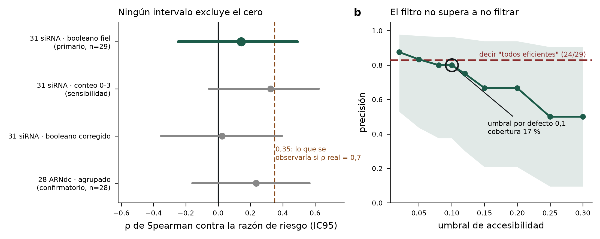

# Resultados de la validación retrospectiva pre-registrada

**Veredicto, con el criterio fijado de antemano: NO CONCLUYENTE.** Es el resultado que el pre-registro declaró como más probable, y el propio documento ya dejó escrito por qué **un nulo no refuta el puntaje**. No se cambió ninguna decisión después de ver los datos: las tres enmiendas están fechadas y commiteadas antes de calcular la primera asociación (`fd0e357` y anteriores).

**Motor.** ViennaRNA 2.7.2, backend `vienna`, 22 °C, `u = 8`, ventana de 21 nt. Los conteos absolutos no son comparables con los de la ola 2; las comparaciones internas sí.

## El análisis primario

Sobre los **31 siRNA de 21 nt** contra *Tc-gawky*, ubicados por coincidencia exacta en el transcrito `XM_008199034.3` (12.405 nt). Dos quedaron excluidos por no existir en ninguna variante de ARNm ni en el cromosoma de la anotación actual (`si1441` y `si2443`), de modo que **n = 29**. El motivo es independiente del desenlace: uno tiene razón de riesgo 4,23 y el otro 33,2.

El booleano de si-Fi21 marca **5 de 29** siRNA como eficientes. Su correlación de rangos con la razón de riesgo es **ρ = +0,142, con intervalo de confianza del 95 % de [−0,247, +0,492]**. El intervalo contiene el cero, así que no se cumple el criterio de «compatible con utilidad»; y contiene también el 0,35 que se observaría si la correlación verdadera fuera 0,7, así que tampoco se cumple el de «fracaso acotado». Cae en la tercera casilla, la que el documento anticipó. `[E]`

Las tres sensibilidades declaradas apuntan en la misma dirección y ninguna excluye el cero: el booleano en modo corregido da ρ = +0,024 [−0,356, +0,397]; el conteo ordinal de condiciones satisfechas, que es el predictor más informativo de los tres, da ρ = +0,325 [−0,058, +0,625]; y quitando los cinco no estimables, ρ = +0,242 [−0,191, +0,596] con n = 24. `[E]`

## El análisis confirmatorio

Los **28 ARNdc** de ocho genes, con el empalme por orden que sigue declarado `[?]`, dan ρ = +0,236 [−0,161, +0,568] en modo fiel y ρ = +0,304 [−0,089, +0,616] en corregido. Dentro de cada gen el promedio es +0,263, con un rango de −0,50 a +1,00 sobre ocho genes de tres o cuatro ARNdc cada uno, que es demasiado poco por grupo para leerlo. `[E]`

**Lo único que se puede decir con los dos conjuntos juntos:** las seis estimaciones son positivas, entre +0,02 y +0,33, y las seis incluyen el cero. La consistencia de signo es débilmente alentadora y no es evidencia: con esta potencia, seis estimaciones del mismo signo sobre datos del mismo trabajo no son seis pruebas independientes.

## La curva precisión-recall

La base manda: de los 29 siRNA, **24 son positivos** por el criterio pre-registrado, así que un clasificador que diga «todos eficientes» acierta el **82,8 %**. Barriendo el umbral de accesibilidad de 0,02 a 0,30, la precisión del filtro va de 0,875 a 0,500 y **en ningún punto supera esa base de forma apreciable**: en el umbral por defecto de 0,1 marca 5 siRNA, acierta 4, y da precisión 0,800 con cobertura del 17 %. Los intervalos de Wilson de esas precisiones van de [0,53, 0,98] en el mejor punto a [0,10, 0,91] en el peor, o sea que **el dato no distingue nada**. `[E]`

El falso positivo nunca se filtra: sobrevive a todos los umbrales del barrido.

## Lo que este resultado sí establece, y lo que no

**No establece** que el criterio de si-Fi21 no sirva. Con n = 29, cinco negativos y la atenuación por fiabilidad del desenlace, un criterio bueno y uno inútil producen intervalos casi indistinguibles. Ése era el punto del cálculo de potencia que motivó el pre-registro.

**Sí establece tres cosas de método, y las tres son reportables.** Primero, que el conjunto etiquetado abierto más grande que existe en insectos **no alcanza** para validar ni para refutar el filtro, y ahora está medido y no argumentado. Segundo, que la restricción de rango que W6/ANA había anticipado es real y visible en el dato: **ningún siRNA del conjunto tiene razón de riesgo cercana a 1**, los autores probaron cosas que mataban mucho o nada. Tercero, que con una base de positivos del 83 % la pregunta «¿cuántos de los que mando a testear andan?» no se puede contestar acá, porque casi todos andan.

## Límites

La prueba **no es independiente de lo publicado**: los autores ya analizaron sus propios descriptores sobre estos mismos 31 siRNA, y dos de los tres que les resultaron predictivos se solapan conceptualmente con las condiciones de si-Fi21. El transcrito de RefSeq y la referencia de los autores difieren por inserciones —los desplazamientos entre la posición del nombre y la hallada van de 280 a 309—, así que cada siRNA se ubicó por secuencia y no por coordenada. El confirmatorio calcula la accesibilidad dentro del fragmento de ~300 pb y no en el contexto del ARNm completo, que es una aproximación heredada del texto original del pre-registro. Todo es *Tribolium castaneum*, un coleóptero: no hay validación en hemípteros.

## Archivos

`resultados/validacion_31sirna.tsv` (las 29 filas con predictor y desenlace), `resultados/validacion_resumen.json` (todas las estimaciones y la curva), `validacion_retrospectiva.png`.
