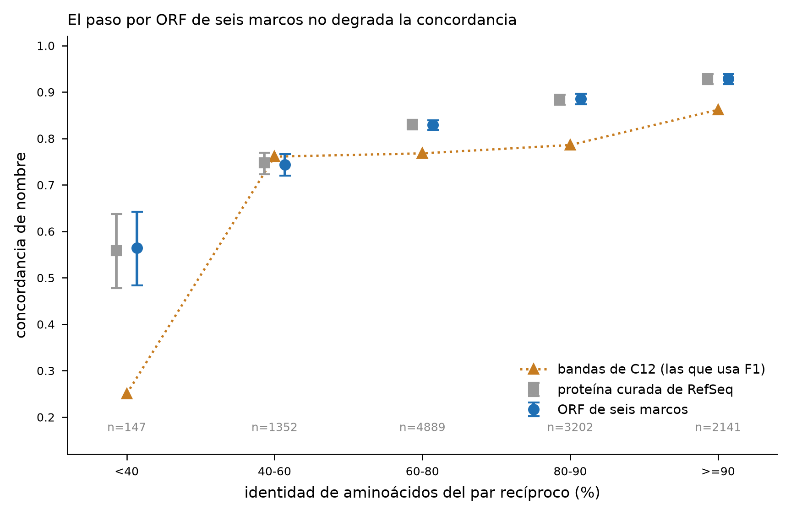

# El supuesto de las bandas, medido: el paso por ORF no las rompe

**Veredicto: el supuesto se sostiene. Traducir un transcripto en seis marcos y quedarse con sus
ORF no degrada la concordancia de nombre respecto de usar la proteína curada —las dos lecturas
son indistinguibles en las cinco bandas, con 11.727 genes en común y ningún intervalo separado—. El reparo aparece en otro
lado: las bandas que `F1` usa, las de `C12`, quedan por debajo de lo que mide el par completo, de
modo que el 81 % que `F1` publica es conservador y no optimista.** Pregunta abierta **56** del
issue #25. Método y criterio de decisión: `PREREGISTRO.md` (commit `7762144`, anterior a la
primera corrida) y su Enmienda 1. Todo local con `diamond` 2.2.8, la misma versión que corrió
`F1`; ninguna secuencia salió de la máquina. Fecha: 2026-10-27.

## Qué se midió y por qué así

`F1` adjunta a cada ortólogo transferido la banda de concordancia que `C12` midió, y de ahí sale
su única cifra de calidad. Pero `C12` midió **entre dos proteomas RefSeq curados**, y `F1` aplica
esas bandas a pares donde el lado consulta es **un ORF de seis marcos de un transcriptoma**. El
informe de `F1` lo declaró `[H]`: supuesto, no medición.

*Macrosteles quadrilineatus* tiene en RefSeq las dos cosas —su proteoma anotado y sus
transcriptos—, así que se puede leer el mismo organismo de las dos maneras contra la misma
referencia (*Homalodisca vitripennis*), cambiando una sola cosa:

- **Brazo P**, la lectura de `C12`: las 34.269 proteínas curadas de MQ contra el proteoma de HV.
- **Brazo O**, la lectura de `F1`: los 117.393 ORF de ≥ 100 aa que salen de traducir en seis
  marcos los 34.256 transcriptos con CDS anotado, contra el mismo proteoma de HV.

En los dos, recíproco con `diamond blastp --more-sensitive`, e ≤ 1e-10, y el acierto es que el
nombre normalizado del ortólogo en HV coincida con el nombre verdadero del gen de MQ —el producto
RefSeq, el mismo campo de los dos lados—. **El código es el de `F1`**: el script importa
`transferir_anotacion.py` y usa sus funciones tal cual, de modo que lo validado es lo que corrió.

La ruta que sugería la entrada 56 —validar contra la curación de `C5`— se descartó por potencia:
ese catálogo tiene del orden de una docena de genes y `C12` necesitó 1.152 pares para cinco
bandas.

## El resultado



Análisis pareado (los 11.727 genes presentes en los dos brazos), lectura inclusiva:

| identidad | brazo P · proteína curada | brazo O · ORF de seis marcos | veredicto |
| --- | --- | --- | --- |
| < 40 % | 55,9 % (IC 47,7–63,7), n = 145 | 56,5 % (IC 48,4–64,2), n = 147 | se sostiene |
| 40–60 % | 74,7 % (IC 72,3–77,0), n = 1.345 | 74,4 % (IC 72,0–76,7), n = 1.352 | se sostiene |
| 60–80 % | 83,0 % (IC 82,0–84,1), n = 4.871 | 82,9 % (IC 81,8–84,0), n = 4.889 | se sostiene |
| 80–90 % | 88,4 % (IC 87,2–89,5), n = 3.220 | 88,5 % (IC 87,4–89,6), n = 3.202 | se sostiene |
| ≥ 90 % | 92,9 % (IC 91,7–93,9), n = 2.146 | 92,9 % (IC 91,7–93,9), n = 2.141 | se sostiene |
| total | **85,0 %** | **85,0 %** | |

Ningún intervalo se separa. La mayor diferencia entre brazos es de **0,6 puntos**, y está en la
banda < 40 %, que por preregistro no decide porque no llega a n = 100; **entre las cuatro bandas
que sí deciden la mayor es de 0,3 puntos** (0,31 en 40–60 %, 0,12 en 60–80 %, 0,15 en 80–90 % y
0,02 en ≥ 90 %). Con la regla
estricta el resultado es el mismo sobre 5.087 genes en común (83,6 % contra 83,6 %), y la banda
< 40 % no alcanza n = 100 y por preregistro no decide. El no pareado da lo mismo y está en
`resultados/bandas_por_brazo.tsv`.

**Esto es más fuerte que «no se detectó diferencia».** Con n ≈ 4.900 en la banda central, una
caída de dos puntos habría caído fuera del intervalo; lo que se observa es una diferencia de
décimas en las cinco bandas a la vez.

## Lo que sí depende de la cobertura

El brazo O permite además medir la concordancia por rótulo de cobertura, que `C12` no podía
(Enmienda 1, post hoc `[H]`):

| cobertura del par | concordancia (IC95) | n |
| --- | --- | --- |
| alta (≥ 70 % en los dos lados) | 86,7 % (86,1–87,4) | 10.617 |
| parcial | 68,6 % (65,7–71,4) | 1.032 |
| fragmento | 71,4 % (65,1–76,9) | 220 |

`parcial` y `fragmento` no se distinguen entre sí —sus intervalos se solapan de lado a lado— así
que el rótulo separa «alta» del resto y nada más; la gradación de tres niveles no se sostiene
(pregunta 64).

O sea que **el ORF mal cubierto sí concuerda peor, unos 16 puntos menos**, y la razón por la que
el brazo O no se degrada en conjunto es que casi todos sus ORF tienen cobertura alta (89,5 %). El
transcriptoma real está algo peor: sobre `GITV01`, los recíprocos con nombre son 83,4 % de
cobertura alta, 13,6 % parcial y 3,0 % fragmento. Ese es el límite del diseño, y acá queda
cuantificado en vez de sólo declarado.

## La cifra de `F1`, recalculada

Aplicando a la distribución real de los 10.280 ORF de `GITV01` las concordancias medidas acá en
lugar de las de `C12` (`resultados/esperado_recalculado.json`):

| esperado de concordancia sobre `GITV01` | valor |
| --- | --- |
| con las bandas de `C12` — **es la cifra que publica `F1`** | 81,2 % |
| con las bandas del brazo O (preregistrado) | 88,5 % |
| reponderado por banda × cobertura, que corrige el exceso de ORF parciales de `GITV01` (`[H]`, post hoc) | **87,4 %** |

**El informe de `F1` no se corrige.** El preregistro de esta validación fija que si la medición
quedaba por encima no se corrige nada hacia arriba, y eso es lo que pasó. Las dos cifras nuevas se
publican como medición al lado de la vieja, no en su lugar. Lo que cambia es cómo se lee el 81 %:
era una cota conservadora, no el valor central.

## El hallazgo lateral: el brazo P no reproduce a `C12`

El brazo P es el diseño de `C12` corrido completo, y **no da lo que `C12` publicó**:

| identidad | `C12` publicado | brazo P (par completo) |
| --- | --- | --- |
| < 40 % | 25,0 % (n = 16) | 56,1 % (n = 148) |
| 40–60 % | 76,1 % (n = 134) | 74,9 % (n = 1.368) |
| 60–80 % | 76,8 % (n = 456) | 83,1 % (n = 5.003) |
| 80–90 % | 78,6 % (n = 336) | 88,4 % (n = 3.316) |
| ≥ 90 % | 86,2 % (n = 210) | 93,0 % (n = 2.240) |
| total | 78,2 % (n = 1.152) | 85,1 % (n = 12.075) |

Las diferencias no son de ruido: en los tres tramos altos el brazo P queda entre 6 y 10 puntos
por encima, con diez veces más pares. **No se midió cuál de las dos causas candidatas lo explica**
y esta investigación no las puede separar: `C12` corrió con BLAST+ sobre una submuestra de 4.000
consultas y un **reverso parcial** (sólo los 3.100 mejores hits), y un reverso parcial puede
declarar recíprocos pares que no lo son; además `diamond` y `blastp` no dan la misma `pident`.
Por preregistro esto **no decide nada** sobre el supuesto —la decisión es O contra P, interna y
pareada— y se reporta aparte. Queda como pregunta abierta.

## Lo que esto no dice

- **No cubre el error de ensamblado.** Un `rna.fna` de RefSeq es un transcripto curado y completo;
  un contig de un TSA puede estar fragmentado, ser quimérico o tener el marco roto. Lo medido es
  el efecto de **traducir en seis marcos y elegir ORF**, que es un componente del supuesto y no el
  supuesto entero. La tabla de cobertura de arriba acota la parte que sí se puede acotar: el
  sentido del sesgo residual es que `GITV01` concuerde algo menos, y la reponderación lo estima en
  1,1 puntos. Lo que no cubre es la quimera ni el marco roto, que no tienen rótulo.
- **No valida la anotación de RefSeq.** Igual que `C12`, mide consistencia entre anotaciones que
  ya derivan de homología. Dos errores iguales cuentan como acierto.
- **No dice nada de *D. maidis*.** Se midió sobre MQ, que es el organismo con las dos lecturas.
  Trasladarlo a `GITV01` supone que el paso ORF afecta igual a los dos transcriptomas.
- **No corrige la reimplementación del normalizador de nombres** de `C12`, cuyo código no quedó
  versionado. Los dos brazos usan el mismo, así que la comparación O contra P es válida aunque el
  normalizador difiera del original; la comparación con las cifras publicadas de `C12`, no del
  todo.
- **No explica por qué el brazo P difiere de `C12`**, como está dicho arriba.

## Cómo reproducirlo

```bash
# proteomas y transcriptos publicos del NCBI, md5 verificados contra md5checksums.txt
mkdir -p work/F1v/ref && cd work/F1v/ref
B=https://ftp.ncbi.nlm.nih.gov/genomes/all/GCF
curl -O $B/021/130/785/GCF_021130785.1_UT_GWSS_2.1/GCF_021130785.1_UT_GWSS_2.1_protein.faa.gz
curl -O $B/028/750/875/GCF_028750875.1_UCM_ALF_1.0/GCF_028750875.1_UCM_ALF_1.0_rna.fna.gz
curl -O $B/028/750/875/GCF_028750875.1_UCM_ALF_1.0/GCF_028750875.1_UCM_ALF_1.0_feature_table.txt.gz
gunzip -k GCF_021130785.1_UT_GWSS_2.1_protein.faa.gz && cd ../../..

# el proteoma de MQ ya estaba en el repo de trabajo, con el sha256 que registro F1
V=research/ola6/F1_transferencia_homologia/validacion_bandas
python $V/scripts/validar_bandas.py       # ~1 min con diamond del entorno `alineador`
python $V/scripts/recalcular_esperado.py
```

Insumos con sus sha256, conteos y veredicto en `resultados/resumen.json`. Las tablas por par
—una fila por consulta recíproca, sin ninguna columna de secuencia— son
`resultados/pares_{P,O}_{estricta,ampliada}.tsv.gz`.
